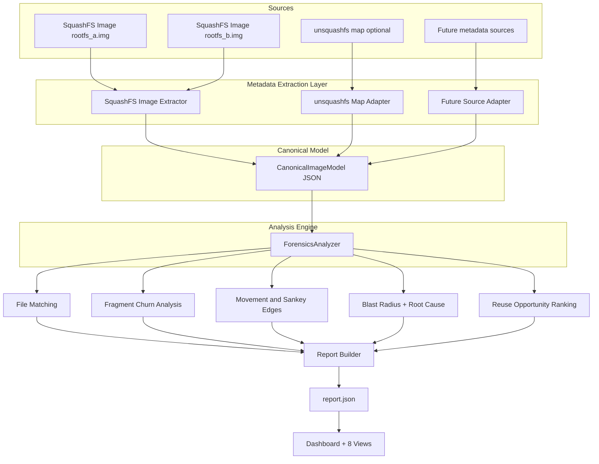

# SquashFS Delta Forensics Studio Architecture

## System Overview

The platform is an offline, local forensic studio:

Input Sources -> Metadata Extraction Layer -> Canonical Model -> Analyzer Engine -> report.json -> Static HTML UI

No server and no database are required.

## Data Flow

## Metadata Extraction Layer

The extraction layer is the single entry point for all input sources. It
consumes raw source formats and emits a canonical `CanonicalImageModel`
that the analysis engine consumes exclusively.

### Components

- `BaseExtractor`: abstract contract for all extractors
- `SquashfsImageExtractor`: parses SquashFS binary structure (superblock,
  inode table, fragment table, block lists) to extract authoritative
  file->fragment relationships
- `UnsquashfsMapAdapter`: adapts existing map files into the canonical model
  (backward compatibility)
- `ExtractorRegistry`: resolves the appropriate extractor by source type/path

### Source Preference

When a SquashFS image is available, the extractor registry prefers direct
inode, fragment-table, and block-list extraction because it provides
authoritative file->fragment relationships that map formats do not contain.

## Canonical Model

The canonical model (`CanonicalImageModel`) is the single contract between
the extraction layer and the analysis engine. It contains:

- `CanonicalFile`: path, inode number, size, fragment_id, fragment_offset,
  block list, start offset
- `CanonicalFragment`: fragment_id, start offset, compressed size,
  uncompressed size, files (authoritative membership)
- `CanonicalImageModel`: image path, source type, files, fragments,
  superblock, extraction diagnostics

The engine never sees raw source formats (map files, image binaries).

## Analyzer Components

- Canonical model consumer: operates exclusively on `CanonicalImageModel`
- File matcher: unchanged / modified / added / deleted / moved
- Fragment analyzer: membership diff and churn ratio
- Movement analyzer: old_fragment -> new_fragment edges
- Root-cause classifier: heuristics with confidence
- Reuse detector: same-size moved file candidates
- Blast radius engine: impacted fragments/files and reuse-loss estimate
- Report generator: strict schema-compatible JSON

## UI Components

- Bootstrap layout and navigation
- DataTables for searchable file/fragment tables
- Plotly for KPI and chart analytics
- D3 and d3-sankey for movement and dependency graph views
- Dark mode and local file import fallback

## Extractor Extensibility

Extractor contracts are abstract classes:

- `BaseExtractor`

`ExtractorRegistry` resolves extractor implementation by source type/path.

To add support for a new source (for example a custom metadata format),
implement a new extractor class and register it in
`forensics_studio/extractors/registry.py`.
