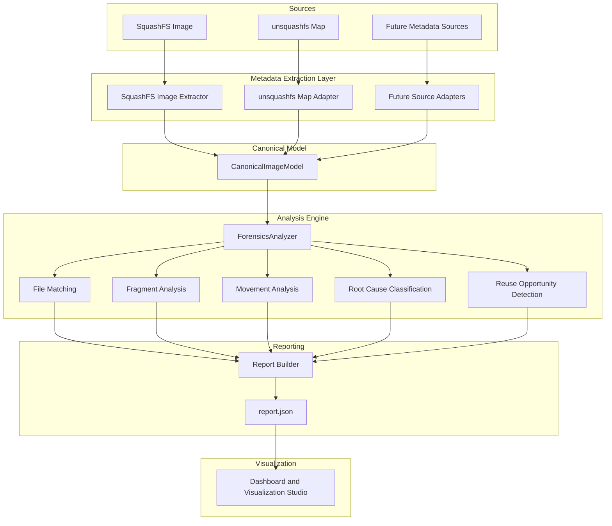

# Architecture Overview

## System Overview

SquashFS Delta Forensics Studio is an offline forensic analysis platform for understanding structural changes between SquashFS filesystem revisions.

The platform follows a layered architecture that separates metadata acquisition, analysis, reporting, and visualization.

```text
Input Sources
    ↓
Metadata Extraction Layer
    ↓
Canonical Model
    ↓
Analysis Engine
    ↓
report.json
    ↓
Static HTML Visualization Studio
```

The entire workflow runs locally without requiring a server, database, or cloud services.

---

## Design Principles

- Source-agnostic analysis
- Offline-first operation
- Explainable forensic results
- Extensible metadata ingestion
- Strict separation of extraction and analysis
- Reproducible report generation
- Static, portable reporting

---

## Data Flow



---

## Metadata Extraction Layer

The metadata extraction layer is the entry point for all supported input sources.

Its responsibility is to consume source-specific formats and convert them into a common representation that can be analyzed consistently.

### Components

#### BaseExtractor

Abstract contract implemented by all metadata extractors.

Provides a consistent interface for importing data into the canonical model.

#### SquashfsImageExtractor

Parses SquashFS images and extracts filesystem metadata such as:

- Superblock information
- Inode metadata
- Fragment metadata
- Block layout information (where available)
- File-to-fragment relationships when derivable from extracted metadata

#### UnsquashfsMapAdapter

Adapts map-file based metadata into the canonical model.

This preserves compatibility with workflows that rely on exported map data.

#### ExtractorRegistry

Resolves and instantiates the appropriate extractor based on source type or source content.

---

## Source Selection Strategy

When a SquashFS image is available, direct extraction is preferred.

Direct image extraction provides the richest available source of filesystem metadata and is preferred whenever supported by the image format and extractor implementation.

Examples include:

- File-to-fragment membership
- Fragment metadata
- Inode information
- Block layout metadata

Map-based extraction remains available for compatibility and supplemental analysis workflows.

---

## Canonical Model

The canonical model serves as the contract between extraction and analysis layers.

All extractors emit the same model regardless of source format.

### Primary Objects

#### CanonicalFile

Represents a filesystem object and includes metadata such as:

- Path
- Inode number
- Size
- Fragment identifier
- Fragment offset
- Block list
- Start offset

#### CanonicalFragment

Represents a filesystem fragment and includes:

- Fragment identifier
- Start offset
- Compressed size
- Uncompressed size
- File membership

#### CanonicalImageModel

Root container for extracted image metadata.

Contains:

- Source information
- File metadata
- Fragment metadata
- Superblock metadata
- Extraction diagnostics

### Architectural Principle

The analysis engine is source-agnostic and operates exclusively on the canonical model.

Raw input formats are isolated within the extraction layer.

---

## Analysis Engine

The analysis engine consumes canonical models and generates structured forensic results.

### Core Components

#### File Matcher

Compares files across revisions using available identity and structural metadata and classifies them as:

- Unchanged
- Modified
- Added
- Deleted
- Moved

#### Fragment Analyzer

Evaluates:

- Fragment churn
- Fragment reuse behavior
- Fragment membership changes when membership metadata is available

#### Movement Analyzer

Identifies structural movement across revisions.

Examples include:

- Offset shifts
- Fragment relocation
- Storage-layout evolution

#### Root Cause Classifier

Applies rule-based heuristics to identify likely causes of change.

Outputs include confidence-scored classifications.

#### Reuse Opportunity Detector

Identifies structures that may be candidates for improved reuse.

Examples include:

- Unchanged content with layout movement
- Similar-sized relocated files
- Fragment-level reuse opportunities

#### Blast Radius Analyzer

Designed to estimate:

- Impact propagation statistics
- Affected fragment counts
- Affected file counts
- Reuse-loss characteristics

#### Report Builder

Converts analysis results into a schema-compatible report.

The generated report becomes the common interface for visualization and downstream processing.

---

## Reporting Layer

Analysis output is serialized into a structured JSON report.

Primary goals include:

- Deterministic output
- Schema validation compatibility
- Portable analysis artifacts
- Long-term reproducibility

### Output Artifacts

#### report.json

Primary analysis result consumed by visualization components.

#### Debug Dataset

Optional export used for:

- Validation
- Troubleshooting
- Forensic investigation
- Regression analysis

---

## Visualization Studio

The visualization layer is a collection of static HTML pages that consume report data directly.

No backend services are required.

### Technology Stack

- Bootstrap for layout and navigation
- DataTables for interactive tables
- Plotly for charts and analytics
- D3 for graphs and relationships
- d3-sankey for movement visualization

### Capabilities

- Dashboard overview
- File exploration
- Fragment exploration
- Movement visualization
- Reuse analysis
- Root-cause investigation
- Validation diagnostics
- Offset analysis

### Offline Operation

The visualization studio can operate from:

- Embedded report data
- Local report files
- Cached report data

This enables fully portable reporting workflows.

### Report Contract

The visualization layer consumes only the generated report format and is intentionally decoupled from extractor and analyzer implementations.

As long as the report schema remains stable, visualization components can evolve independently from extraction and analysis logic.

---

## Extensibility

The platform is designed to support additional metadata sources without requiring changes to the analysis engine.

### Adding a New Source

1. Implement a new extractor using the `BaseExtractor` contract.
2. Convert source metadata into a `CanonicalImageModel`.
3. Register the extractor with `ExtractorRegistry`.

Once registered, the new source becomes available to the entire analysis pipeline.

### Architectural Benefit

Because the engine consumes only canonical models:

- New source formats do not require analyzer changes.
- Reporting logic remains unchanged.
- Visualization components continue to operate without modification.

This separation enables long-term extensibility while preserving a stable analysis workflow.

---

## Current Limitations

The architecture is designed to support comprehensive SquashFS analysis; however, some extraction and analysis capabilities remain under active development.

Examples include:

- Directory table parsing
- Full block descriptor extraction
- Additional SquashFS compression formats
- Enhanced fragment membership propagation

Refer to `ROADMAP.md` for planned improvements, known limitations, and implementation priorities.