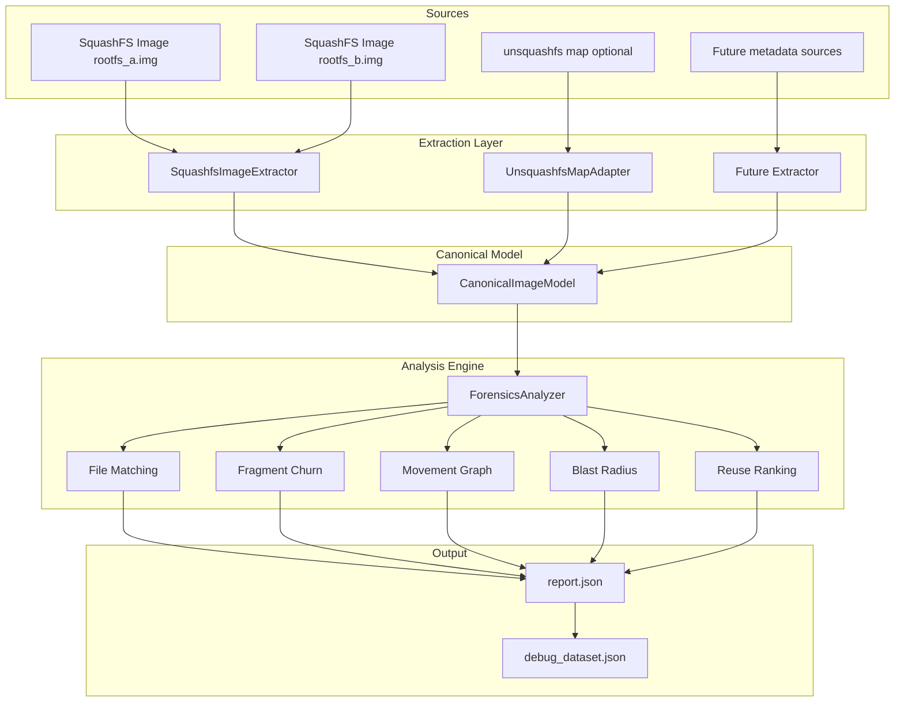
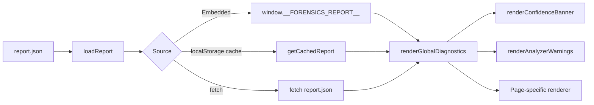

# Full Workspace Architecture Analysis

> **Date**: 2026-09-04
> **Scope**: Complete analysis of the SquashFS Delta Forensics Studio workspace

---

## 1. System Overview

The **SquashFS Delta Forensics Studio** is a local, offline forensic workbench that analyzes build-to-build SquashFS fragment churn and reuse-loss behavior. It follows a strict pipeline:

```
Input Sources → Metadata Extraction Layer → Canonical Model → Analyzer Engine → report.json → Static HTML UI
```

No server, no database — everything runs locally and produces a static report consumed by a browser-based UI.

---

## 2. Backend Architecture

### 2.1 Package Structure

```
forensics_studio/
├── extractors/          # NEW: Metadata extraction layer
│   ├── base.py          # BaseExtractor abstract contract
│   ├── squashfs_image.py # SquashfsImageExtractor (binary parsing)
│   ├── unsquashfs_map.py # UnsquashfsMapAdapter (backward compat)
│   └── registry.py      # ExtractorRegistry (magic-number detection)
├── models/
│   ├── canonical.py     # NEW: CanonicalImageModel, CanonicalFile, CanonicalFragment, BlockDescriptor
│   └── types.py         # AnalysisResult, FileRecord, FragmentRecord, MapFileEntry, etc.
├── analyzer/
│   └── engine.py        # ForensicsAnalyzer (operates on canonical model only)
├── parsers/             # LEGACY: kept for compatibility
│   ├── base.py          # BaseMapParser, BaseFragmentMetadataParser
│   ├── map_parser.py    # GenericMapParser
│   ├── fragment_json_parser.py
│   └── registry.py      # ParserRegistry
├── reporting/
│   └── generator.py     # write_report, write_debug_dataset
├── utils/
│   └── io.py            # copy_report_to_web_data, write_inline_report_js, create_web_bundle
└── cli.py               # argparse CLI entry point
```

### 2.2 Data Flow (Backend)



### 2.3 Key Design Decisions

**1. Canonical Model as the Single Contract**

`CanonicalImageModel` is the source-agnostic contract between extractors and the engine. It contains:
- `files`: list of `CanonicalFile` — path, inode number, size, fragment_id, fragment_offset, block_list, start_offset
- `fragments`: list of `CanonicalFragment` — fragment_id, start_offset, compressed_size, uncompressed_size, files (authoritative membership)
- `superblock`: SquashFS superblock metadata
- `extraction_diagnostics`: per-source diagnostics

**2. Engine Decoupling**

`ForensicsAnalyzer.analyze()` accepts only `CanonicalImageModel` objects. The internal `_canonical_to_entries()` method converts canonical models to internal `MapFileEntry` records — this is the single conversion point, keeping the engine format-agnostic.

**3. Source Preference**

`ExtractorRegistry` detects SquashFS images by magic number (`0x73717368`, "hsqs" little-endian) and prefers direct inode/fragment-table/block-list extraction because it provides authoritative file→fragment relationships that map formats lack.

**4. Confidence Model**

`_confidence_level()` returns:
- `HIGH`: direct file→fragment membership from SquashFS image extraction
- `MEDIUM`: file rows + fragment rows as independent datasets
- `LOW`: only one dataset present

**5. Backward Compatibility**

The `UnsquashfsMapAdapter` adapts existing map files into the canonical model, supporting pipe-delimited, CSV, whitespace key-value, and whitespace file-row formats.

---

## 3. SquashFS Image Extractor Deep Dive

`SquashfsImageExtractor` parses the binary SquashFS structure:

### 3.1 Superblock Parsing
- Reads 96 bytes at offset 0
- Extracts: magic, inode count, block size, fragment count, compression type, inode/fragment table start offsets, etc.

### 3.2 Fragment Table
- Reads metadata block pointers (8 bytes each)
- Each metadata block has a 2-byte header (size + compression flag)
- Parses 16-byte fragment entries: `start (Q) + size (I) + unused (I)`
- **Limitation**: Compressed fragment metadata blocks are skipped (recorded as diagnostic)

### 3.3 Inode Table
- Walks metadata blocks sequentially
- Attempts zlib decompression for compressed blocks via `_try_decompress_metadata_block()`
- Parses regular (`SQUASHFS_REG_TYPE`) and extended regular (`SQUASHFS_LREG_TYPE`) inodes
- Extracts: inode number, file size, start block, fragment index, fragment offset
- **Limitation**: File paths are synthetic (`inode-{number}`) because directory table parsing is not implemented

### 3.4 Block List
- Currently simplified: assumes a single block per file with `compressed_size = file_size`
- **Limitation**: Does not read the actual block descriptor list from the data region

---

## 4. Analysis Engine Deep Dive

`ForensicsAnalyzer` produces a 15-key `AnalysisResult`:

| Key | Description |
|-----|-------------|
| `summary` | File/fragment counts, reuse ratio, membership status |
| `files` | Per-file delta records (status, impact, reuse, root cause) |
| `fragments` | Per-fragment delta records (churn, membership, offsets) |
| `movement_graph` | old_fragment → new_fragment edges |
| `blast_radius` | Impacted fragments/files per changed file |
| `reuse_opportunities` | Ranked reuse candidates |
| `root_causes` | Root cause classification with confidence |
| `heatmap_data` | Fragment churn, movement, impact, reuse |
| `executive_summary` | Top-20 disruptive files/fragments |
| `parser_validation` | Source traceability (file/line/rule) |
| `data_confidence` | HIGH/MEDIUM/LOW + membership status |
| `relationship_graph` | FILE→BLOCK and FRAGMENT→RANGE nodes/edges |
| `debug_dataset` | Full debug export |
| `warnings` | Parser/modeling warnings |
| `offset_analysis` | Storage timeline, offset movement, cascades |

### Key Analysis Methods

- `_classify_file_status()`: unchanged / moved / modified / added / deleted based on start offset + block chain comparison
- `_block_chain_churn()`: symmetric difference / union of block sets
- `_impact_score()`: weighted combination of status, offset delta, block churn
- `_reuse_score()`: 100 for unchanged, 0 for added/deleted, churn-based for moved/modified
- `_classify_root_cause()`: offset shift vs. block chain change heuristics
- `_fragment_movement_graph()`: movement edges for modified fragments
- `_offset_analysis()`: storage timeline, offset movement, image shift statistics, cascades

---

## 5. Frontend Architecture

### 5.1 Structure

```
web/
├── report.html                    # Dashboard (KPI cards, pie, bar, treemap, heatmap)
├── pages/
│   ├── side-by-side.html          # Fragment OLD vs NEW file membership
│   ├── file-explorer.html         # Searchable file delta table
│   ├── fragment-explorer.html     # Fragment delta + membership table
│   ├── sankey.html                # D3 Sankey movement diagram
│   ├── blast-radius.html          # Impact analysis per source file
│   ├── reuse-opportunities.html   # Ranked reuse candidates
│   ├── heatmaps.html              # 4 heatmap views
│   ├── parser-validation.html     # Source traceability + confidence
│   └── offset-analysis.html       # Storage timeline + movement cascades
├── assets/
│   ├── css/styles.css             # Theme (light/dark), status chips
│   ├── data/report.json           # Generated report
│   ├── data/report.inline.js      # Embedded report for offline use
│   └── js/                        # 11 JS modules
```

### 5.2 Frontend Data Flow



### 5.3 Key Frontend Patterns

- **`common.js`**: Shared utilities — `loadReport()` with 3-tier fallback (embedded → localStorage → fetch), `resolveAssetPath()` for pages/ subdirectory, `initDataTable()`, `statusChip()`, `formatList()`, `renderConfidenceBanner()`, `renderAnalyzerWarnings()`
- **Membership gating**: `fragment_explorer.js` and `blast_radius.js` check `report.summary.has_fragment_membership` and disable membership-dependent views when unavailable
- **Plotly**: Used for all charts (pie, bar, treemap, heatmap, scatter)
- **D3 + d3-sankey**: Used for Sankey movement diagram and blast dependency graph
- **DataTables**: Searchable/sortable tables with `initDataTable()`

---

## 6. Data Contracts

### 6.1 Canonical Model (Input Contract)

```json
{
  "image_path": "squashfs_images/rootfs_a.img",
  "source_type": "squashfs_image",
  "files": [
    {
      "path": "inode-1",
      "inode_number": 1,
      "size": 1234,
      "fragment_id": "0",
      "fragment_offset": 100,
      "block_list": [{"block_index": 0, "start_offset": 4096, "compressed_size": 1024, "uncompressed_size": 1024, "is_compressed": true}],
      "start_offset": 4096,
      "metadata": {"perm": 33188, "inode_type": "regular"}
    }
  ],
  "fragments": [
    {
      "fragment_id": "0",
      "start_offset": 100000,
      "compressed_size": 4096,
      "uncompressed_size": 4096,
      "files": ["inode-1", "inode-2"]
    }
  ],
  "superblock": {"magic": 1936819192, "inodes": 100, "block_size": 131072, ...},
  "extraction_diagnostics": {"source_file": "...", "files_extracted": 100, ...}
}
```

### 6.2 Report Schema (Output Contract)

Defined in `schema/report.schema.json` with 15 required top-level keys. The schema validates:
- `summary`: file/fragment counts, reuse ratio, membership status
- `files[]`: per-file delta with source traceability
- `fragments[]`: per-fragment delta with membership lists
- `movement_graph[]`: old→new fragment edges
- `blast_radius[]`: impact analysis
- `reuse_opportunities[]`: ranked candidates
- `root_causes[]`: classification with confidence
- `heatmap_data`: 4 sub-arrays
- `executive_summary`: top-20 rankings
- `parser_validation`: source traceability
- `data_confidence`: level + membership status
- `relationship_graph`: nodes/edges
- `debug_dataset`: full debug export
- `warnings[]`: string list
- `offset_analysis`: storage timeline + cascades

---

## 7. Strengths

1. **Clean separation of concerns**: Extraction layer → canonical model → engine → report → UI
2. **Source-agnostic engine**: The engine never sees raw source formats
3. **Authoritative membership**: SquashFS image extraction provides file→fragment relationships that maps lack
4. **Backward compatibility**: Map files still work via the adapter
5. **Confidence model**: HIGH/MEDIUM/LOW with safety gating for membership-dependent analytics
6. **Source traceability**: Every record carries source file/line/rule for auditability
7. **Offline-first**: No server, no database, static HTML UI with embedded report fallback
8. **Strong typing**: Dataclasses with `slots=True` throughout
9. **Comprehensive debug export**: `debug_dataset.json` for forensic investigation
10. **Extensible**: `BaseExtractor` abstract contract + `ExtractorRegistry` for future sources

---

## 8. Identified Gaps and Improvement Opportunities

### 8.1 SquashFS Extractor Limitations

| Issue | Location | Impact |
|-------|----------|--------|
| **No directory table parsing** — file paths are synthetic (`inode-{N}`) | `squashfs_image.py` | Cannot match files across images by real path; file delta analysis is degraded |
| **Block list is simplified** — assumes single block with `compressed_size = file_size` | `squashfs_image.py` | Block-chain churn analysis is inaccurate |
| **Compressed fragment metadata blocks are skipped** | `squashfs_image.py` | Fragment table may be incomplete |
| **No LZ4/LZO/XZ decompression** — only zlib attempted | `squashfs_image.py` | Non-zlib images fail to extract inodes |
| **Duplicate `_inode_size_for_type` method** | `squashfs_image.py` lines 429 and 440 | Code duplication bug |

### 8.2 Engine Limitations

| Issue | Location | Impact |
|-------|----------|--------|
| **`_analyze_fragments_independent` always sets `membership_available=False`** | `engine.py` | Even when SquashFS provides membership, fragment records don't reflect it |
| **`_canonical_to_entries` loses fragment membership** — `old_fragment`/`new_fragment` on `FileRecord` are always `None` | `engine.py` | File-level fragment membership not propagated to report |
| **`_fragment_movement_graph` uses `moved_files` as a hack** — stores `start_delta` string instead of actual moved file paths | `engine.py` | Sankey diagram shows deltas, not real file movements |
| **`_reuse_opportunities` hardcodes `old_fragment="N/A"`** | `engine.py` | Reuse opportunities don't reference actual fragments |
| **`_build_parser_validation` hardcodes `membership_status="not_present_in_source_map"`** | `engine.py` | Doesn't reflect SquashFS membership availability |
| **`_detect_warnings` checks `row.membership_available` on `FragmentRecord`** which is always `False` | `engine.py` | Warning always fires even for SquashFS sources |

### 8.3 Frontend Limitations

| Issue | Location | Impact |
|-------|----------|--------|
| **`side_by_side.js` `pathMoved()` checks `row.old_fragment`/`row.new_fragment`** which are always `None` | `side_by_side.js` | "moved" classification never triggers |
| **`fragment_explorer.js` membership gating** checks `has_fragment_membership` but the engine never sets it on `FragmentRecord` | `fragment_explorer.js` | Membership columns always show "Insufficient" |
| **`blast_radius.js`** — `report.blast_radius` is always `[]` because the engine never populates it | `blast_radius.js` | Blast radius view always shows "no changed files" |

### 8.4 Architectural Gaps

1. **No JSON schema validation in the pipeline** — `report.schema.json` exists but is never enforced
2. **No test suite** — `docs/FUTURE_EXTENSIBILITY.md` mentions "Golden sample test suite" and "Unit tests for SquashFS superblock/inode/fragment-table parsing" but none exist
3. **Legacy parsers are dead code** — `forensics_studio/parsers/` is kept for compatibility but the engine no longer uses it; `ParserRegistry` is instantiated in `ForensicsAnalyzer.__init__` but never used
4. **`old_fragment_path`/`new_fragment_path` are deprecated but still in the API** — the engine deletes them immediately
5. **No directory table support** — the most impactful gap for real-world SquashFS analysis

---

## 9. Recommended Next Steps (Priority Order)

1. **Implement directory table parsing** in `SquashfsImageExtractor` to resolve real file paths (critical for cross-image file matching)
2. **Implement proper block descriptor list reading** from the data region (critical for accurate block-chain churn)
3. **Propagate fragment membership through the engine** — set `old_fragment`/`new_fragment` on `FileRecord`, populate `FragmentRecord.membership_available`, and populate `blast_radius`
4. **Fix the duplicate `_inode_size_for_type` method** in `squashfs_image.py`
5. **Add JSON schema validation** to the reporting pipeline
6. **Add unit tests** for superblock/inode/fragment-table parsing
7. **Remove dead code** — legacy parsers, unused `ParserRegistry` in engine, deprecated fragment path args
8. **Add LZ4/LZO/XZ decompression support** for broader SquashFS image compatibility